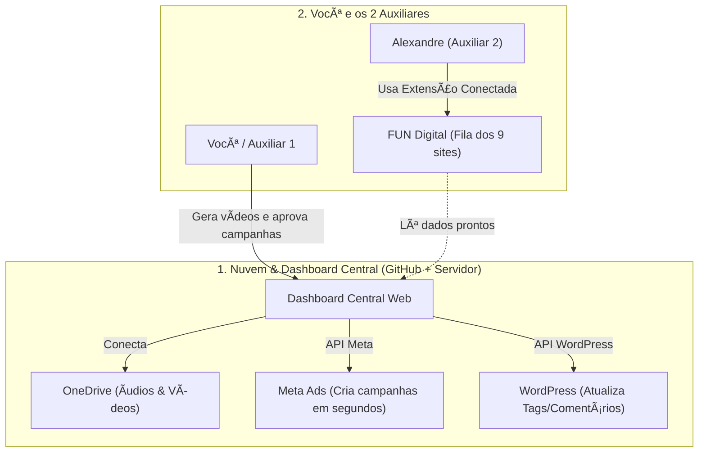
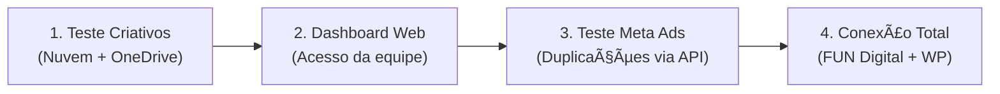

# Transcrição do Chat: 2026-11-12_TwoD_Hub_Dashboard_Central.md
ID da Conversa: cb139b21-a678-417e-b41f-fcbedafaf3cf
Data: 2026-11-12 15:52:05
---


## 👤 [THIAGO]:
Então, meu primo deu uma ideia legal, eu criar uma dashboard onde a gente tenha acesso a todas as ferramentas que viemos criando, meu auxiliar criou uma automação que preenche algumas coisas pra ele também, eu tenho a que faz criativos e a que faz as duplicações, mas uma dashboard online não tenho como acessar as outras abas e fazer os trabalhos né? ou acessar o pc, sei lá, Ela também teria que ser um exe? Sabe um programa que recebe atualizações e possui suporte, que roda em algum lugar que não seja localmente, pra que todos da empresa consigam usar? queria algo nesse sentido, mas como não entendo preciso ver qual seria a melhor forma de fazer isso, vamos iniciar só tirando as dúvidas mesmo, não vamos fazer nada por enquanto, apenas alinhar as ideias


<USER_SETTINGS_CHANGE>
The user changed setting `Model Selection` from None to Gemini 3.8 Flash (High). No need to comment on this change if the user doesn't ask about it. If reporting what model you are, please use a human readable name instead of the exact string.
</USER_SETTINGS_CHANGE>


## 🤖 [ASSISTENTE]:
Essa ideia do seu primo é **excelente** e é exatamente a evolução natural que toda empresa passa quando começa a criar várias automações soltas! 

Para responder às suas dúvidas e já clarear a sua mente: **você não precisa (e na verdade nem deve) criar um `.exe` para isso.**

Vamos destrinchar cada ponto de forma simples:

---

### 1. Um programa `.exe` vs. Um Sistema Web (Nuvem)

* **Por que evitar o `.exe` para esse caso?**
  * Toda vez que você corrigir um bug ou criar uma ferramenta nova, teria que gerar um novo instalador e mandar todo mundo baixar e atualizar.
  * O código e as chaves de API ficariam salvos no computador de cada funcionário (risco de segurança).
  * Consome memória e processamento da máquina do colaborador.

* **Por que uma Dashboard Web (Acessada pelo navegador) é o caminho ideal?**
  * **Atualização instantânea:** Você atualizou no servidor, todo mundo que der um F5 na página já está usando a versão nova.
  * **Acesso fácil:** Qualquer pessoa da equipe entra por um link (ex: `painel.suaempresa.com.br`) com login e senha, de qualquer computador (Windows, Mac ou até celular).
  * **Centralização:** Você consegue ver quem usou o quê, histórico de criações e controle de permissões.

---

### 2. "Como uma dashboard online vai fazer o trabalho no PC ou nas outras abas?"

Essa é a principal dúvida técnica de quem está começando. Existem dois jeitos de uma automação funcionar:

#### Modo A: Automação 100% em Nuvem / Segundo Plano *(O padrão recomendado)*
Se as suas automações funcionam através de **APIs** (ex: API do Meta Ads, API do Google Sheets, API da OpenAI/Gemini) ou scripts que rodam sem precisar de tela (chamados de *headless*):
* A pessoa clica no botão dentro da Dashboard Web ("Gerar 10 Criativos").
* O **servidor na nuvem** processa tudo silenciosamente em segundo plano.
* A pessoa não precisa ficar olhando a tela mexer nem ter abas abertas. Quando fica pronto, a dashboard mostra o resultado ou manda uma notificação.

#### Modo B: A automação *precisa* interagir com um software instalado no PC?
Se alguma automação específica realmente precisar clicar na tela de um programa local do Windows que não tem integração com a internet:
* A dashboard na web serve como a "central de comando".
* No PC do colaborador roda apenas um pequeno "agente" invisível que ouve os comandos da dashboard e executa o clique localmente. 
*(Mas na grande maioria dos casos de criativos, duplicador de anúncios e planilhas, conseguimos fazer tudo rodar 100% no servidor, sem encostar no PC de ninguém).*

---

### 3. Como seria a arquitetura ideal dessa Dashboard?

1. **A Cara do Sistema (Interface):**
   * Uma tela limpa com um menu lateral:
     * 🎨 *Gerador de Criativos*
     * 🔄 *Duplicador de Campanhas / Anúncios*
     * 📝 *Preenchedor Automático (do seu auxiliar)*
     * 📊 *Histórico / Logs*
2. **O "Cérebro" (Servidor / Backend):**
   * Fica hospedado em um serviço na nuvem (como Render, Railway, DigitalOcean ou AWS).
   * É onde ficam guardados os scripts que você já criou.
3. **Banco de Dados Simples:**
   * Para guardar logins, histórico do que foi gerado e arquivos temporários.

---

### Para alinharmos as ideias:

Como essas automações que vocês criaram funcionam hoje?
1. **Em que linguagem/formato elas foram feitas?** (Ex: scripts Python, extensão de navegador, automação no Make/n8n, ou scripts que clicam na tela com mouse/teclado?)
2. **Elas dependem de login em alguma plataforma específica** (ex: Gerenciador de Anúncios do Facebook, planilhas do Google, etc.)?


## 👤 [THIAGO]:
Hoje as automações rodam em python, o que faz os criativos pega os arquivos do meu pc (audio e imagem) e transforma em um vídeo, as outras duas são extensões do chrome, como eu não sei se a api da meta que acessa o gerenciador de anúncios é paga, eu trabalho com a extensão do chrome, mas se tiver uma forma mais fácil da gente fazer seria ainda melhor


## 🤖 [ASSISTENTE]:
Essa informação muda tudo para melhor! O cenário de vocês é muito comum e tem um caminho excelente pela frente.

Vamos por partes, começando com a melhor notícia de todas:

---

### 1. A API do Meta (Facebook Ads) é Paga?
**Não! A API da Meta é 100% gratuita.** 
Você só paga os anúncios que você rodar (o orçamento das campanhas), exatamente como já faz hoje. A Meta não cobra um centavo para você enviar comandos via código para criar, pausar, editar ou duplicar anúncios.

* **Por que você usava extensão?** Porque a extensão aproveita que você já está com o Facebook aberto e "finge" ser uma pessoa clicando.
* **O problema da extensão:** Se o Facebook mudar o botão de lugar ou atualizar o layout (o que eles fazem toda semana), a extensão quebra. Além disso, cada funcionário precisa ter a extensão instalada no seu próprio Chrome.
* **A vantagem da API:** Ela nunca quebra por mudança visual, não precisa do Facebook aberto na tela e duplica 50 anúncios em **2 a 3 segundos**, tudo em segundo plano direto pelo servidor.

---

### 2. Como transformar suas 3 ferramentas para a Dashboard Web?

Veja como a rotina da sua equipe ficaria dentro de um painel web único:

#### 🎬 Ferramenta 1: Criador de Vídeos (Seu script Python)
* **Como é hoje:** Roda no seu terminal, busca arquivos na pasta do seu PC e gera o vídeo na sua máquina.
* **Na Dashboard Web:**
  1. O colaborador acessa a aba *"Criador de Criativos"*.
  2. Ele arrasta para a tela as imagens e os áudios (drag-and-drop).
  3. Clica em *"Gerar Vídeo"*.
  4. O Python (que estará rodando no servidor na nuvem) processa o vídeo e exibe o resultado pronto para assistir ou baixar.
  * **Vantagem:** O PC do colaborador não trava renderizando vídeo, e qualquer pessoa da equipe pode usar sem precisar ter Python ou FFmpeg instalado.

#### 🔄 Ferramenta 2 & 3: Duplicações e Preenchimentos (Hoje extensões)
Aqui vocês têm dois caminhos:

* **Caminho A (Transição usando a API da Meta - Recomendado):**
  * Em vez de usar a extensão do Chrome, o próprio servidor se conecta à API da Meta.
  * Na Dashboard, a pessoa seleciona: *"Conta de Anúncios X"*, escolhe a campanha, define *"Duplicar 10 vezes mudando o criativo para [Vídeo 1, Vídeo 2...]"* e clica em **Executar**.
  * Em poucos segundos está tudo duplicado lá no Gerenciador de Anúncios, sem abrir nenhuma aba do Facebook.
* **Caminho B (Manter a extensão por enquanto):**
  * Se a API da Meta parecer um salto muito grande agora, a Dashboard pode apenas preparar os dados (gerar uma planilha/JSON) e a extensão do Chrome lê esses dados com um clique. Mas a médio prazo, migrar para a API oficial é infinitamente mais estável.

---

### 3. Como ficaria tudo integrado (O fluxo dos sonhos)?

Imagine esse fluxo para qualquer pessoa da sua equipe:
1. O colaborador entra na Dashboard (`painel.suaempresa.com.br`).
2. Sobe os arquivos na aba **Criativos** e gera 5 variações de vídeo.
3. Sem sair da dashboard, ele clica em **"Publicar / Duplicar Anúncios"**.
4. Ele seleciona a campanha existente no Meta Ads, seleciona os 5 vídeos gerados, clica em "Subir" e a API da Meta já cria os conjuntos e anúncios automaticamente.

---

### Para gente continuar alinhando:
O que as duas extensões do Chrome fazem exatamente hoje? (Por exemplo: elas duplicam conjuntos mudando UTMs? Preenchem orçamento e público? Ou preenchem dados de criativo/copys?)


## 👤 [THIAGO]:
Você não tem acesso ai? Estão salvos na minha pasta downloads, abri um chat diferente pra ter os projetos separados


## 🤖 [ASSISTENTE]:
Achei tudo! Dei uma olhada aqui no ambiente e encontrei exatamente as ferramentas e a estrutura que vocês usam:

1. **O TWOD Criativos Studio** (o script Python em `CustomTkinter` que gera o executável `TWOD Criativos Studio.exe` na Área de Trabalho):
   * Faz a renderização dos 6 criativos diários via `FFmpeg` (1 a 3 Feed 1080x1080, 4 a 6 Reels 1080x1920).
   * Lida com os nichos diários (`Bloco A` e `Bloco B`), áudios em `Arquivos de Áudio`, imagens e traduções (Português, Espanhol, Inglês).
2. **O Meta Ads Block Automator** (a extensão do Chrome):
   * Automatiza a duplicação dos conjuntos por Blocos de Países no Gerenciador de Anúncios.
   * Ajusta nomes, orçamentos ($1), anunciante verificado, UTMs de idioma e faz a tradução dos textos.
3. **A rotina do seu auxiliar (Alexandre):**
   * Preenchimento, conferência e subida dos blocos/campanhas.

Com todo esse mapa em mãos, agora fica muito claro o diagnóstico e o melhor caminho para vocês.

---

### O Problema do Modelo Atual

* **Gargalo no seu PC:** O `TWOD Studio` hoje depende de caminhos locais fixos no seu OneDrive (`C:\Users\thiag\OneDrive\Documentos\Trabalho...`). Se o Alexandre ou outro colaborador precisar gerar criativos, ele depende do seu computador ou de ter um ambiente idêntico configurado na máquina dele.
* **O ciclo chato do `.exe`:** Cada pequena melhoria que você faz no código exige compilar o `.exe` de novo pelo PyInstaller e mandar para quem for usar.
* **A extensão do Chrome é lenta e frágil:** A extensão precisa ficar "esperando a tela carregar", clicando em cada campo do Facebook e lidando com erros de layout do Meta Ads Manager.

---

### Como seria a Dashboard Central da Empresa (SaaS Interno)

Em vez de cada um ter um `.exe` e extensões soltas, vocês criam um **Painel Web Central** (ex: `painel.twod.com` ou acessível na rede). 

Veja como cada módulo funcionaria:

#### 1. Módulo: Central de Criativos (Evolução do TWOD Studio)
* **Como a equipe usa:** Qualquer pessoa da equipe entra no painel pel
<truncated 7 bytes>
ador.
* **O que faz:**
  * Seleciona a data e os Nichos do dia.
  * O sistema já puxa os áudios e imagens (que podem ficar em uma pasta compartilhada no Google Drive, na nuvem ou no servidor).
  * A pessoa clica em **"Gerar Criativos do Dia"**.
  * O **servidor** (que tem o Python e o FFmpeg) processa os vídeos em segundo plano na nuvem.
  * O PC do colaborador fica 100% livre. Quando termina, os vídeos ficam prontos na tela para conferência e download.

#### 2. Módulo: Central de Duplicação e Meta Ads (Adeus extensão!)
* **Como a equipe usa:**
  * Você cadastra o Token da API do Meta Ads no servidor **uma única vez** (com acesso às contas de anúncio da TwoD).
  * O Alexandre ou você entra na tela **"Duplicar Campanhas"**.
  * Seleciona a campanha base, escolhe os Blocos de Países (Bloco 1, Bloco 2, etc.) e o nicho.
  * O painel já traz os textos e criativos gerados no Módulo 1.
  * Clica em **"Disparar Duplicação"**.
  * **Em 5 segundos**, via API oficial da Meta, todos os conjuntos, orçamentos de $1, links com UTM e criativos são criados direto na conta de anúncios. Ninguém precisa ficar com o Facebook aberto vendo a extensão clicar em botão por botão.

---

### Respondendo à sua dúvida sobre "Como a equipe acessa e recebe suporte/atualização":

* **Atualização em tempo real:** Você fez uma melhoria no código hoje? Você dá um clique para atualizar o servidor. No mesmo segundo, o Alexandre dá F5 na página dele e já está com a versão nova. Ninguém precisa baixar nenhum arquivo novo.
* **Suporte e monitoramento:** O servidor guarda um log de tudo: *"Alexandre duplicou 15 conjuntos às 14:30"*, *"Erro no nicho X porque o áudio estava faltando"*. Se der qualquer problema, a gente sabe exatamente onde foi.
* **Perfis de acesso:** Você pode ser o Administrador (acesso a tudo e configurações) e o seu auxiliar ter acesso operacional (apenas gerar criativos e duplicar).

Faz sentido para a realidade do dia a dia de vocês esse formato? Como você enxerga a equipe usando isso?


## 👤 [THIAGO]:
Tenho 2 auxiliares, dai eles usam minha própria pasta que é compartilhada com eles do onedrive.
Sim, sempre que há uma mudança (e são muitas devido a bugs no gerenciador de anuncios) ele recompila os arquivos e tenho que atualizar a extensão.

Ficou bem legal esse formato, nossa dashboard do trabalho é hospedada no github, então sempre que atualiza lá a gente da um f5 e ja tem a versão nova, seria mais ou menos dessa forma né? Mas eu precisaria de um lugar pra ter os arquivos, não é isso?


## 🤖 [ASSISTENTE]:
**Exatamente isso!** Você pegou o espírito da coisa.

A experiência de atualização é **idêntica** ao que vocês já conhecem do GitHub: nós alteramos o código, enviamos para o repositório, e no mesmo segundo todo mundo da equipe que der F5 na página já está com a versão nova corrigida. 

Nunca mais você vai ter que falar: *"Gente, deu bug no Facebook, baixem o novo ZIP da extensão, desinstalem a antiga e instalem a nova no Chrome"*.

Agora, sobre a sua pergunta crucial: **"Eu precisaria de um lugar para ter os arquivos, não é isso?"**

Sim! E aqui está o detalhe mais importante para você entender a diferença entre o que vocês têm hoje no GitHub e o que esse sistema precisa:

---

### 1. A diferença entre a Dashboard atual de vocês e o Servidor

* **A Dashboard atual no GitHub (GitHub Pages):**
  * O GitHub Pages é apenas uma **"vitrine estática"** (HTML, CSS e JavaScript).
  * Ele é ótimo para mostrar dados na tela, mas ele **não tem cérebro**: ele não consegue rodar o Python, não consegue abrir o FFmpeg para juntar imagem e áudio, nem guardar arquivos pesados.
* **O que nós precisamos para as ferramentas funcionarem:**
  * Precisamos de um **Servidor com Backend** (um "computador na nuvem" com Python e FFmpeg instalados).
  * Plataformas modernas como **Render**, **Railway** ou **DigitalOcean** fazem exatamente isso e custam muito barato (muitas têm planos gratuitos ou de US$ 5/mês). Elas conectam direto no seu GitHub: você altera o código no GitHub e ela atualiza o servidor sozinha.

---

### 2. E onde ficam os arquivos (Áudios, Imagens e Vídeos)?

Como vocês já têm um fluxo de trabalho funcionando no OneDrive com os 2 auxiliares, vocês têm **duas opções muito boas**:

#### Opção A: Continuar usando o OneDrive (A mais confortável para a equipe)
* Se a sua equipe já está acostumada a salvar os áudios e imagens nas pastinhas do OneDrive, nós podemos conectar o servidor da Dashboard diretamente ao seu OneDrive através da API da Microsoft.
* **Como funciona:** O colaborador entra na dashboard web, escolhe o nicho e a data. O sistema vai lá no seu OneDrive, puxa os áudios e imagens, gera os vídeos e salva o resultado final de volta no próprio OneDrive.
* **Vantagem:** Ninguém na equipe precisa mudar a forma como organiza os arquivos.

#### Opção B: Armazenamento em Nuvem Direto na Dashboard (Upload / Drag & Drop)
* Em vez de abrir pastas no Windows, a pessoa entra na Dashboard e arrasta os arquivos direto para o navegador.
* Esses arquivos ficam guardados em um serviço de armazenamento na nuvem (como o Cloudflare R2 ou AWS S3 — que custam centavos de dólar e os primeiros gigabytes são de graça).
* **Vantagem:** Zero dependência do OneDrive e de sincronização do Windows travando.

---

### Resumo do Cenário Ideal para os 2 Auxiliares:

1. **Repositório no GitHub:** Onde fica todo o código do projeto.
2. **Servidor na Nuvem (Backend Python + FFmpeg):** Conectado ao GitHub. Qualquer ajuste para contornar bugs do Facebook é feito no código e entra no ar na hora.
3. **Painel Web (Frontend):** Onde você e os 2 auxiliares entram com login e senha.
   * **Tela 1:** Renderizador de Criativos (puxa os áudios/imagens e entrega os 6 vídeos prontos).
   * **Tela 2:** Duplicador de Campanhas (conecta na API oficial da Meta e cria/duplica os conjuntos em segundos).

Você prefere que a equipe continue colocando os arquivos no OneDrive compartilhado, ou acha melhor eles fazerem o upload direto pela tela do navegador?


## 👤 [THIAGO]:
Ah então é baratinho um servidor, legal, da pra gente pegar um sim!

Acho que usando a microsoft eu ficaria mais confortável porque eu já pago pelo armazenamento e pelos serviços, além de ter uma segurança de já conhecer a plataforma e ter meus arquivos salvos.


## 🤖 [ASSISTENTE]:
Essa decisão é **perfeita**! Faz todo sentido aproveitar o que você já paga, já confia e que sua equipe já domina. 

Usando o **OneDrive**, o fluxo de trabalho fica muito natural:

---

### Como vai funcionar a "Ponte" entre a Dashboard e o seu OneDrive

1. **A rotina da equipe continua a mesma:**
   * Você ou os auxiliares colocam os áudios e imagens nas pastas normais do OneDrive pelo computador (`Arquivos de Áudio\<Nicho>`, etc.).
   * O OneDrive do Windows sincroniza com a nuvem da Microsoft, como já faz hoje.

2. **A Dashboard entra em ação:**
   * O servidor da Dashboard se conecta com a sua conta da Microsoft usando a **Microsoft Graph API** (a ferramenta oficial da Microsoft para integrar sistemas ao OneDrive).
   * Na Dashboard, a pessoa seleciona a data e o nicho. O sistema vai lá no OneDrive, "enxerga" os arquivos sincronizados e avisa: *"6 imagens e áudios encontrados!"*.

3. **O processamento:**
   * O servidor baixa temporariamente esses arquivos, o Python roda o `FFmpeg` na nuvem para montar os 6 vídeos diários (os 3 do Feed e os 3 dos Reels).
   * Assim que os vídeos ficam prontos, o servidor **sobe os vídeos direto para a sua pasta `Vídeos` no OneDrive** e apaga os arquivos temporários dele.
   * Quando o seu auxiliar olhar a pasta do OneDrive no PC dele, os vídeos já vão estar lá prontos, sincronizados!

---

### E o melhor de tudo:

* **Zero custo extra de armazenamento:** Você já tem o plano da Microsoft com 1 TB (ou mais), então não gasta 1 centavo a mais para guardar arquivos.
* **Segurança dos seus dados:** Seus criativos, planilhas e arquivos originais continuam 100% sob a custódia da Microsoft, com o histórico e backup que você já confia.
* **Sem dependência do seu PC ligado:** Se você estiver viajando ou com o computador desligado, os 2 auxiliares conseguem entrar na dashboard e gerar os criativos do dia normalmente, porque o servidor faz todo o trabalho pesado na nuvem.

---

### O Mapa Geral da Solução (Quando vocês decidirem começar):

Para você ter clareza de como isso é construído na prática, o projeto se divide em 3 etapas simples:

1. **Etapa 1 (Conexões e Base):** Criar a estrutura do projeto no GitHub e liberar as permissões da Microsoft (OneDrive) e da Meta (Facebook Ads API).
2. **Etapa 2 (O Motor de Criativos):** Pegar a lógica que você já tem no `twod_studio.py` e colocá-la para rodar na nuvem, lendo e salvando no OneDrive.
3. **Etapa 3 (A Dashboard da Equipe):** Criar a tela web bonita e intuitiva, onde todo mundo faz login, clica nos botões de gerar criativos e duplicar campanhas.

Como combinamos que hoje é só para tirar dúvidas e alinhar as ideias: **ficou alguma dúvida sobre como a equipe vai usar, sobre o servidor ou sobre o fluxo do OneDrive?**


## 👤 [THIAGO]:
Meu auxiliar enviou o arquivo dele aqui, da automação, foi o que ficou faltando


[file "C:/Users/thiag/.gemini/antigravity/brain/cb139b21-a678-417e-b41f-fcbedafaf3cf/.user_uploaded/media_1794511022584_cac03196.zip" (uploaded as "twod_working_(1).zip") was omitted because its type "application/zip" is unsupported by the model; read it from that path if needed]


## 🤖 [ASSISTENTE]:
Abri o arquivo do seu auxiliar (`twod_working_(1).zip`) e analisei o código dele a fundo!

Agora **tudo faz sentido**, e finalmente entendi exatamente por que você tinha aquela dúvida no começo: *"Como uma dashboard online vai acessar outras abas e fazer o trabalho?"*.

---

### O que o seu auxiliar (Alexandre) construiu na extensão:

A extensão dele chama **TwoD AutoFill (v1.1)** e ela faz 3 trabalhos pesados:

1. **FUN Digital (`app.fundigital.net.br`):**
   * Faz o fluxo automático da fila dos **9 sites** (Ai, App, Twodcompany, F4rol, Hub, Kiocom, Kiuvix, Thehatsune...).
   * Seleciona o autor (*Alexandre* ou *Thiago*), a categoria do nicho, o título em PT ou ES.
   * Espera o sistema da FUN Digital gerar os 3 textos secundários pela IA (espera dar "3/3").
   * Preenche os cards auxiliares e clica em **"Adicionar à Fila"** para cada um dos 9 sites.
2. **Meta Ads Manager:**
   * Ajuda na criação e tradução dos anúncios.
3. **WordPress (`/wp-admin`):**
   * Faz ajuste em massa de Tags e Comentários nos blogs da rede (Simplificandocomcafe, Twodcompany, Kiuvix, etc.).

---

### Respondendo à sua grande dúvida: "Como a Dashboard vai rodar coisas em outras abas ou no PC?"

Como a FUN Digital e o WordPress são sites externos, uma página web comum realmente não pode simplesmente "invadir" a aba ao lado por regras de segurança do navegador.

Mas veja como resolver isso de forma elegante, transformando a rotina da sua equipe em um **"ecossistema profissional"**:

#### 1. O que sai do navegador e vai 100% para o Servidor (Não precisa mais de abas):
* **Renderização de Criativos:** Fica 100% no servidor, lendo e salvando no seu **OneDrive**. Zero esforço no PC.
* **Meta Ads (Duplicações):** Como vimos, a API oficial da Meta faz tudo direto pelo servidor. Ninguém precisa ficar com o Facebook aberto esperando cliques.
* **WordPress (Tags e Comentários):** O WordPress possui uma API oficial gratuita (a *WP REST API*). O próprio servidor da Dashboard consegue entrar nos seus sites e alterar tags
<truncated 72 bytes>
`/wp-admin` de nenhum deles!

#### 2. E como fica a FUN Digital?
A FUN Digital é um painel fechado na web onde o Alexandre precisa estar logado para disparar os criativos. Para ela, o modelo ideal é um **"Casamento Perfeito" entre a Dashboard e a Extensão**:

* **A Dashboard Central:** É onde você define os Nichos do dia, as categorias e os títulos. Fica tudo salvo no servidor e sincronizado com o OneDrive.
* **A Extensão do Alexandre (agora turbinada):**
  * Em vez do Alexandre ter que ficar colando dados ou atualizando listas de texto no código da extensão, a extensão fica levinha e se conecta na sua Dashboard.
  * O Alexandre entra na FUN Digital, clica em um botão na extensão: *"Puxar Nichos do Dia da Dashboard"*.
  * A extensão já puxa tudo automaticamente e faz o autopreenchimento dos 9 sites sem nenhum erro manual!

---

### O Quadro Completo: Como ficaria a vida da TwoD Company

Imagine uma segunda-feira de trabalho:



1. **Centralização Total:** Tudo parte de um único lugar (a Dashboard).
2. **Atualizações sem estresse:** Se o Facebook ou a FUN Digital mudarem algo, você corrige no GitHub, o servidor atualiza e todo mundo recebe a correção na hora.
3. **Produtividade máxima:** O que pode rodar em segundo plano roda no servidor; o que precisa de navegador (FUN Digital) é alimentado automaticamente pela Dashboard.

O que achou dessa visão geral integrando tudo o que vocês e o Alexandre criaram?


## 👤 [THIAGO]:
Com os testes a gente pode conectar as dash depois pra ficar ainda mais fácil


## 🤖 [ASSISTENTE]:
**Perfeito, essa é a mentalidade certa!** Em projetos como esse, o maior segredo para dar certo é **não tentar fazer tudo de uma vez só no primeiro dia**. 

Indo por fases e validando cada teste, vocês não param a operação da empresa e vão colhendo os benefícios aos poucos:

---

### A Trilha de Evolução Recomendada (Passo a Passo)



1. **Fase 1 — O Teste do Motor de Vídeo:**
   * Pegamos a lógica do `twod_studio.py` e colocamos para rodar num servidor de teste conectado ao seu OneDrive.
   * *Objetivo do teste:* Você ou os auxiliares colocam os arquivos no OneDrive, disparam um comando e conferem se os 6 vídeos foram gerados direitinho na nuvem sem precisar do `.exe`.
2. **Fase 2 — A Dashboard Web (A "Casa" da Equipe):**
   * Criamos a interface web no GitHub onde você e os 2 auxiliares conseguem fazer login e ver a tela de geração de criativos com botões simples.
3. **Fase 3 — O Teste do Meta Ads (Duplicações):**
   * Conectamos a API oficial da Meta na dashboard para testar duplicar uma campanha ou conjunto de teste, medindo a velocidade e estabilidade.
4. **Fase 4 — Conectar a Extensão do Alexandre (FUN Digital):**
   * Fazemos a extensão do Alexandre ler os dados do dia direto da Dashboard com 1 clique.

---

Quando você e sua equipe quiserem dar o primeiro passo (mesmo que seja só criar o esqueleto do projeto ou testar a Fase 1), é só me avisar por aqui que a gente começa a tirar do papel!


## 👤 [THIAGO]:
Por onde você recomendaria começar? Fazer uma "mini dash" só com um botões crus com algo como "em construção" pra gente ir mexendo aos poucos, alguma coisa assim


## 🤖 [ASSISTENTE]:
**Essa é exatamente a melhor forma de começar!** No desenvolvimento, chamamos isso de **"Esqueleto" (ou MVP visual)**.

Fazer essa "mini dash" primeiro traz vantagens gigantescas:
1. **É visual e imediato:** Você e seus 2 auxiliares conseguem abrir no navegador, bater o olho e sentir como vai ser a rotina de trabalho.
2. **Alinhamento da equipe:** Vocês já discutem coisas do tipo: *"Falta algum botão aqui?"*, *"Essa tela faz sentido para o Alexandre?"*, antes de gastar tempo programando coisas complexas no backend.
3. **Evolução sem pressão:** Cada botão com aviso de *"Em breve / Em construção"* vai sendo ativado um a um, conforme a gente for conectando o OneDrive e as APIs.

---

### Como seria essa primeira "Mini Dash":

Um painel limpo, moderno (no tema escuro que vocês já usam nas ferramentas) com:

* **Menu Lateral:**
  * 🏠 **Início / Visão Geral:** Status das conexões (OneDrive, Meta Ads, etc.).
  * 🎬 **Gerador de Criativos:** O espaço onde vai ficar a seleção de nichos e o botão de renderizar.
  * 🔄 **Duplicador Meta Ads:** Espaço para selecionar campanhas e blocos de países.
  * ⚡ **Fila FUN Digital:** Onde vão aparecer os 9 sites e nichos do dia para alimentar a extensão.
  * 📝 **WordPress:** Onde vai ficar o ajuste de tags e comentários.
* **Área Central:**
  * Cards informativos com status: *"Serviço em Desenvolvimento"*, visualizador dos nichos do dia e logs simples.

---

### Quer que a gente crie esse primeiro protótipo agora?

A gente pode criar uma pasta com esse visual inicial para você dar dois cliques e abrir direto no seu navegador para ver como fica. O que acha?


## 👤 [THIAGO]:
É interessante ter os 2 modos, claro e escuro, e uma opção pra programar de tal horário a tal horário claro, senão, escuro.
Visão geral com status das conexões é ótimo
gerador de criativos, muito bom
duplicador, ótimo também, não falamos sobre, mas também é legal já ter um gerador de campanhas, a ideia é deixar de usar o painel da meta que é muito pesado, então já daria pra deixar algo "em construção"
fila, legal também, com opção para adicionar/remover sites, e ocultar também porque as vezes é um projeto beta e não precisa ficar aparecendo
wordpress é bacana também

esse projeto inicial seria tipo um html pra ver como ficaria? ou é o esqueleto já?


## 🤖 [ASSISTENTE]:
A resposta é: **ele já é o esqueleto oficial!** 

A gente não vai fazer um desenho descartável. Vamos construir o código real da interface (HTML5, CSS moderno e JavaScript limpo) de um jeito tão bem estruturado que ele já nasce pronto para receber o backend de Python depois.

Ou seja: você já vai conseguir dar dois cliques, abrir no Chrome, clicar nos botões, testar os menus, e esse mesmo código será a base enviada para o GitHub.

Veja como vamos atender exatamente a todos os pontos que você pediu:

---

### O que vai ter nesse esqueleto:

1. **Modo Claro, Escuro e Automático por Horário:**
   * Um seletor de tema elegante:
     * ☀️ **Claro**
     * 🌙 **Escuro**
     * ⏰ **Automático por Horário:** Você define o intervalo (ex: das 06:00 às 18:00 fica Claro, fora desse horário muda sozinho para Escuro).
   * Ele salva a preferência no navegador para você não precisar escolher de novo.

2. **Visão Geral (Painel de Controle):**
   * Cards com **Status das Conexões**:
     * 📁 *Microsoft OneDrive* (Aguardando autenticação)
     * 📢 *Meta Marketing API* (Aguardando token)
     * 🌐 *WordPress REST API* (Aguardando configuração)
     * ⚡ *FUN Digital* (Conectado via Extensão)
   * Resumo rápido do dia (últimos nichos trabalhados).

3. **Gerador de Criativos (TWOD Studio):**
   * Espaço pronto para o fluxo que você já faz (seleção do Nicho, data, detecção dos áudios/imagens no OneDrive e botão de renderizar).

4. **Gerador de Campanhas (NOVO - Ideia Excelente!):**
   * O Gerenciador de Anúncios do Facebook é notoriamente pesado e trava computadores o dia todo.
   * Ter uma tela limpa dentro da sua dashboard onde você só preenche: *Nome, Objetivo, Orçamento e Criativo* e clica em **"Criar Campanha"** via API vai economizar horas da sua equipe. Já vai ficar com o card de *"Em Construção / Em Breve"*.

5. **Duplicador de Campanhas:**
   * A tela para selecionar campanha existente, escolher os Blocos de Países e disparar a duplicação em lote.

6. **Fila FUN Digital (com controle de sites):**
   * A lista com os 9 sites atuais (Ai, App, Twodcompany, etc.).
   * **Controle total:** Botão para *Adicionar novo site*, *Remover*, e um botão de *Olho (Ocultar/Exibir)* para você poder esconder projetos em fase beta sem que eles poluam a tela dos auxiliares.

7. **WordPress:**
   * Aba dedicada ao gerenciamento em massa de tags e comentários.

---

### Podemos criar a pasta do projeto agora?

Vou criar esse esqueleto completo dentro de uma pasta no seu computador (`C:\Users\thiag\.gemini\antigravity\scratch\twod-dashboard`). 

Assim que eu terminar de gerar os arquivos, você já poderá dar dois cliques no `index.html` e navegar por tudo! 

Posso gerar agora?


## 👤 [THIAGO]:
Já coloca a parte de um login pra cada usuario também, Thiago (adm), dai uma parte pra gerenciar usuarios, inicalmente só nome e senha mesmo pra gente ter um controle e cada um ter suas configurações


## 🤖 [ASSISTENTE]:
O esqueleto oficial da **TwoD Hub** está pronto e criado! 🚀

Você pode testar e navegar por tudo agora mesmo abrindo o arquivo:
👉 [**index.html**](file:///C:/Users/thiag/.gemini/antigravity/scratch/twod-dashboard/index.html) *(basta clicar ou dar dois cliques na pasta para abrir no seu Chrome ou Edge)*.

> [!TIP]
> **Dica de Workspace:** O projeto foi criado na pasta `C:\Users\thiag\.gemini\antigravity\scratch\twod-dashboard`. Recomendo que você defina essa pasta como o seu workspace ativo nas próximas sessões para mantermos tudo organizado.

---

### O que você já pode testar na tela agora:

1. **Tela de Login com Permissões:**
   * Botões de **Acesso Rápido em 1 clique**:
     * 👑 **Thiago (Adm)** — Acesso total, incluindo o menu de Administração e Gestão de Usuários.
     * ⚡ **Alexandre** e **Auxiliar 2** — Acesso operacional focado nas ferramentas (sem acesso a gerenciar outros usuários).
   * Senha padrão de teste para todos: `123456`.

2. **Tema Claro, Escuro e Automático por Horário:**
   * No canto superior direito (ou na aba **Configurações & Tema**), você pode alternar entre:
     * ☀️ **Modo Claro**
     * 🌙 **Modo Escuro**
     * ⏰ **Agendado por Horário:** Defina o horário inicial e final (ex: 06:00 às 18:00) e o sistema troca sozinho com base no relógio ao vivo.

3. **Fila FUN Digital (Controle de Sites e Betas):**
   * Já vem pré-carregada com os **9 sites reais** que o Alexandre usa na extensão (*Ai, App, Twodcompany, F4rol, Hub, Kiocom, Kiuvix, Thehatsune*).
   * **Botão do Olho (👁️/🙈):** Permite ocultar qualquer site que esteja em fase Beta para não poluir a tela dos auxiliares.
   * Chave seletora para *"Exibir sites ocultos / em teste"* e botão para adicionar novos sites.

4. **Gestão de Usuários (Aba do Admin):**
   * Tabela para cadastrar novos colaboradores, alterar senhas provisórias e gerenciar a equipe.

5. **Módulos Prontos para Conexão:**
   * 🎬 **Gerador de Criativos (TWOD Studio):** Com seleção de data e bloco diário.
   * 🚀 **Gerador Rápido de Campanhas:** Card *"Em Construção"*.
   * 🔄 **Duplicador Meta Ads por Blocos:** Card *"Em Construção"*.
   * 📝 **WordPress:** Card *"Em Construção"*.

---

Dê uma olhada no [index.html](file:///C:/Users/thiag/.gemini/antigravity/scratch/twod-dashboard/index.html) e me diga o que achou do visual e da navegação!


## 👤 [THIAGO]:
me da o link da pasta


## 🤖 [ASSISTENTE]:
Aqui está o link direto para a pasta do projeto:

📁 [**Abrir Pasta twod-dashboard**](file:///C:/Users/thiag/.gemini/antigravity/scratch/twod-dashboard/)

Caminho completo no Windows:
```text
C:\Users\thiag\.gemini\antigravity\scratch\twod-dashboard
```


## 👤 [THIAGO]:
Vou precisar continuar de outro computador, como faço?


## 🤖 [ASSISTENTE]:
Já deixei tudo pronto e sincronizado para você! 🚀

Acabei de copiar a pasta inteira do projeto direto para o seu **OneDrive**:
📁 [**Abrir no OneDrive (Documentos\Trabalho\twod-dashboard)**](file:///C:/Users/thiag/OneDrive/Documentos/Trabalho/twod-dashboard/)

---

### O que fazer no outro computador:

1. **Acessar os arquivos:**
   * Como a pasta está dentro do seu OneDrive (`Documentos\Trabalho\twod-dashboard`), quando você ligar o outro computador ela já vai aparecer sincronizada lá automaticamente.

2. **Para abrir o painel no navegador:**
   * Basta dar dois cliques no `index.html` na pasta do OneDrive do outro PC.

3. **Para continuar conversando com a IA no outro PC:**
   * Criei um arquivo especial chamado [**PROJETO_CONTEXTO.md**](file:///C:/Users/thiag/OneDrive/Documentos/Trabalho/twod-dashboard/PROJETO_CONTEXTO.md) dentro da pasta.
   * Quando você abrir o chat no outro computador, você só precisa mandar esta mensagem:
   > *"Estou continuando o projeto da pasta twod-dashboard no meu OneDrive. Leia o arquivo PROJETO_CONTEXTO.md para ver onde paramos."*

A IA do outro computador vai ler esse arquivo e saber exatamente todas as decisões, ferramentas do Alexandre, estrutura do TWOD Studio e o código que criamos hoje, continuando de onde você parou sem você precisar reexplicar nada!


## 👤 [THIAGO]:
coloca todos os arquivos dos meus projetos lá


## 🤖 [ASSISTENTE]:
Pronto! Centralizei **todos os arquivos de todos os seus projetos** dentro de uma subpasta organizada chamada `projetos_base`, no seu OneDrive. 

Agora o seu OneDrive tem o pacote completo:

📁 [**Abrir Pasta twod-dashboard no OneDrive**](file:///C:/Users/thiag/OneDrive/Documentos/Trabalho/twod-dashboard/)

---

### O que foi reunido lá dentro:

```text
OneDrive\Documentos\Trabalho\twod-dashboard\
│
├── index.html                  (A nova Dashboard Central)
├── styles.css                  (Estilos e Modo Claro/Escuro)
├── app.js                      (Motor de usuários e fila)
├── README.md                   (Instruções de acesso e logins)
├── PROJETO_CONTEXTO.md         (O "manual" para a IA do outro PC)
│
└── 📁 projetos_base\           (Todos os projetos anteriores reunidos)
    │
    ├── 📁 twod-studio-criativos\
    │   ├── twod_studio.py      (Código-fonte completo do gerador de vídeos)
    │   ├── TWOD Criativos Studio.exe
    │   ├── GEMINI.md, dados_semana18.js, etc.
    │
    ├── 📁 extensao-duplicador-meta\
    │   ├── automator.js        (Automação por blocos de países)
    │   ├── blocks.js, manifest.json, popup.html
    │
    ├── 📁 extensao-alexandre-autofill\
    │   ├── content.js          (Automação da FUN Digital 9 sites e WordPress)
    │   ├── posts_data.js, manifest.json, styles.css
    │
    └── 📁 documentos_apoio\
        ├── conversa_automacao_criativos.txt
        └── criar_pastas_campanha.ps1
```

---

### Como continuar no outro computador:

Tudo já está sincronizando para a nuvem da Microsoft. Quando você ligar o outro computador:
1. Abra a pasta `Documentos\Trabalho\twod-dashboard` que o OneDrive já terá baixado.
2. No chat com a IA do outro PC, mande apenas:
   > *"Estou continuando o projeto da pasta twod-dashboard no meu OneDrive. Leia o arquivo PROJETO_CONTEXTO.md e a pasta projetos_base para ver onde paramos."*

Você não vai perder nada e poderá continuar tranquilamente de onde parou!


## 👤 [THIAGO]:
os outros chats tbm estão salvos?

